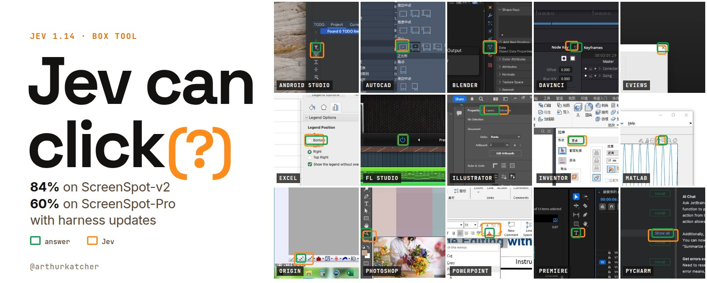
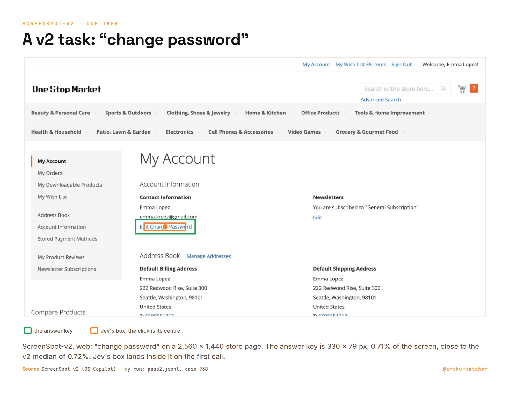

# jev-click-bench

How well does Jev 1.14's `box` tool click? I ran it on both standard click benchmarks, ScreenSpot-v2 and ScreenSpot-Pro, with the official scoring code: 2,853 clicks, every request and response logged. On ordinary screens it hits 84%. On pro apps at 4K it hits 19%. A zoomed second look takes Pro to 43% and a third to 60%, with the same model and nothing trained.

Write-up: [Teaching Jev's box to click 3x better, benchmarked: my 5 rules](https://arthurkatcher.com/blog/teaching-jevs-box-to-click-3x-better), also [on X](https://x.com/arthurkatcher/status/2111499108733038723).



| Benchmark | Setup | Calls per click | Score | Cost per 1,000 clicks |
|---|---|---|---|---|
| ScreenSpot-v2 (1,272) | Jev box | 1 | 84.36% | $0.15 |
| ScreenSpot-v2 | + 2x zoom | 2 | 87.89% | $0.30 |
| ScreenSpot-Pro (1,581) | Jev box | 1 | 18.66% | $0.16 |
| ScreenSpot-Pro | + 2x zoom | 2 | 42.76% | $0.32 |
| ScreenSpot-Pro | + 4x zoom, post-hoc | 3 | 60.15% | $0.48 |

- Raw is one call on the whole screenshot. Raw and zoom rows are the same run, so each zoom row is the same cases seen again. A separate raw pass scored 83.33% (v2) and 19.17% (Pro), the same within noise.
- The 4x step was designed after the 2x result, and its prediction was committed before it ran ([`analysis/zoom4x/prediction.txt`](analysis/zoom4x/prediction.txt)): 63.2%, range 59.7 to 66.2. It is a labelled extra. 42.76% stays the clean Pro number.
- Every score uses the official eval code and answer key, including the cases where the label audit thinks the key is wrong.
- Costs are what OpenRouter billed, logged on every record. The key balance matched the logs to the cent.

## The 5 rules

The harness I would ship from these runs. Each rule rests on a measured result below.

1. Send the screenshot with one box question and click the centre of the box.
2. Ask again on a crop half the width and height around that box, and map the answer back.
3. Skip the second look on phone screens, where the misses are wrong picks.
4. Trust zoomed answers at 0.9 confidence or more. Send the rest to a check or a stronger model.
5. On dense 4K apps, add a third look at a quarter crop.

## The runs in pictures

### Where Jev lands on ScreenSpot-Pro


Jev's three bars are orange. One call sits at the bottom, next to Claude Sonnet 4. The other two bars are the same model with nothing trained; only the harness changed. Other scores are as published, each with its own setup (single-shot, zoom, tools or thinking). Sources: [`analysis/leaderboard/screenspot-pro.md`](analysis/leaderboard/screenspot-pro.md).

### What it costs


Jev's points are billed costs. The other models' floors are estimates from image tokens and list prices, in [`analysis/leaderboard/cost-latency.md`](analysis/leaderboard/cost-latency.md).

### A v2 task and a Pro task

The two benchmarks on the same 2,560 x 1,440 screen size. On v2 the target is a link, 0.71% of the screen, and Jev hits it on the first call:



On Pro the target is a toolbar icon, 0.025% of the screen, about 20 x 17 px in the image Jev gets. The box lands just below it:


### The zoom step


The crop goes in at the same image size as the full screenshot, so a small target arrives twice as big at the same token cost.

### What the second look adds


On v2 the second look fixed 95 misses and broke 50 hits. On Pro it fixed 436 and broke 55, about seven times the v2 gain. On v2, zoomed answers at 0.9 confidence or more were right 98.7% of the time.

### Why Pro gains seven times more


Size decides most of it. Pro is still harder at the same apparent size, by 20 to 35 points against v2: dense toolbars of icons with no text, and 295 cases that ask in English about a Chinese interface.

### Where zoom stops


Looking closer at the wrong spot rarely helps. The misses were sorted by AI reviewers in the label audit ([`analysis/LABELS-audit-pro.md`](analysis/LABELS-audit-pro.md)).

### Every chapter


Mobile never moved. Its misses are wrong picks, a median 95 px away on text and 228 px on icons, against 10 to 19 px on desktop and web. A half crop of a phone screen also often cuts off the row label that names the target.

## Benchmark bugs found on the way

Looking at every miss turned up label problems in both benchmarks. They were reported upstream, and none of them changes a score here.

| Benchmark | Misses with a label issue | Broken tasks | Reported |
|---|---|---|---|
| ScreenSpot-v2 | 43 of 271 | 4 wrong keys, 1 duplicate case | [OS-Atlas #65](https://github.com/OS-Copilot/OS-Atlas/issues/65) |
| ScreenSpot-Pro | 65 of 905 | 3 wrong labels, 1 contradictory pair, 2 near-duplicates | [Issue #32](https://github.com/likaixin2000/ScreenSpot-Pro-GUI-Grounding/issues/32), [HF #5](https://huggingface.co/datasets/likaixin/ScreenSpot-Pro/discussions/5) |

The 271 are every v2 case at least one run missed, and the 905 every Pro case the second look still missed. On Pro the label problems are worth at most 2.3 points, so the misses there really are the model. Details: [`analysis/LABELS-audit.md`](analysis/LABELS-audit.md), [`analysis/LABELS-audit-pro.md`](analysis/LABELS-audit-pro.md).

## What this does not show

- One model version, `jev-1.14-20261014`, and box is a preview feature. The next version could move every number.
- Jev is not deterministic. On v2 the same request twice returns the same box only 30% of the time, though the click moves a median 4.8 px.
- No other model was re-run. Their scores are as published, and their costs are estimates.
- ScreenSpot is one click on a still screenshot. A real agent also has to notice when the target is missing, and box always returns a box.

## Run it yourself

1. Python 3.10+, `pip install requests pillow`.
2. Get the data from Hugging Face into `data/`: [OS-Copilot/ScreenSpot-v2](https://huggingface.co/datasets/OS-Copilot/ScreenSpot-v2) into `data/screenspot-v2/`, [likaixin/ScreenSpot-Pro](https://huggingface.co/datasets/likaixin/ScreenSpot-Pro) (revision 210e78d) into `data/screenspot-pro/`. Screenshots are not in this repo.
3. Copy `.env.example` to `.env` and put in an OpenRouter key.
4. Run the offline tests, then a pass. A full v2 pass costs about $0.19 and a Pro stage about $0.25, so any number here can be checked for under a dollar.

```
python3 tests/test_offline.py                                  # no API calls
python3 screenspot.py run --pass 1 --workers 4                 # ScreenSpot-v2, raw
python3 screenspot.py run --pass 2 --zoom --max-cost 0.40      # raw + 2x zoom in one run
python3 screenspot.py --bench pro run --pass 2 --zoom --workers 4 --max-cost 0.60   # ScreenSpot-Pro
python3 screenspot.py report results/pass1.jsonl
```

Every command, the frozen protocol and the zoom rules are in [`docs/PROTOCOL.md`](docs/PROTOCOL.md).

## What's in here

- `jev.py`: the Jev call (OpenRouter decisions API, model pinned to `typesafe/jev-1.14`). The key is never logged.
- `screenspot.py`: runner, official scoring, report, compare and the zoom stages.
- `results/`: one JSON line per click with Jev's raw response, box, click, hit and cost, plus the run logs.
- `analysis/`: the deep audits ([v2](analysis/AUDIT-run2.md), [Pro](analysis/AUDIT-pro-run2.md)), the label audits, sourced leaderboards, cost research, the 4x prediction and the figure scripts.
- `REPORT.md`: the running report, every number with where it comes from.
- `docs/PROTOCOL.md`: protocol, layout and commands. `docs/img/`: the figures above.
- `tests/`: offline tests against a mocked API, no spend.

## License

Code: MIT. Datasets: ScreenSpot-v2 (Apache-2.0, OS-Copilot) and ScreenSpot-Pro (MIT, Li et al.), not included here. The result records and figures quote their instructions, answer boxes and a few screenshots. The official eval code the scoring copies (SeeClick, OS-Atlas, ScreenSpot-Pro-GUI-Grounding) is not redistributed.

By Arthur Katcher, [@arthurkatcher](https://x.com/arthurkatcher) on X and [arthurkatcher.com](https://arthurkatcher.com).
