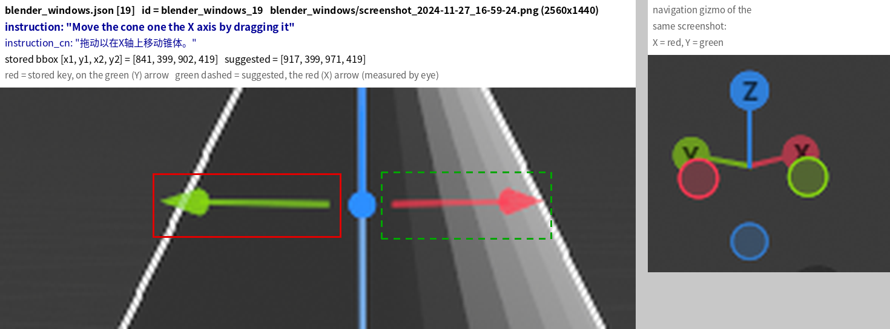
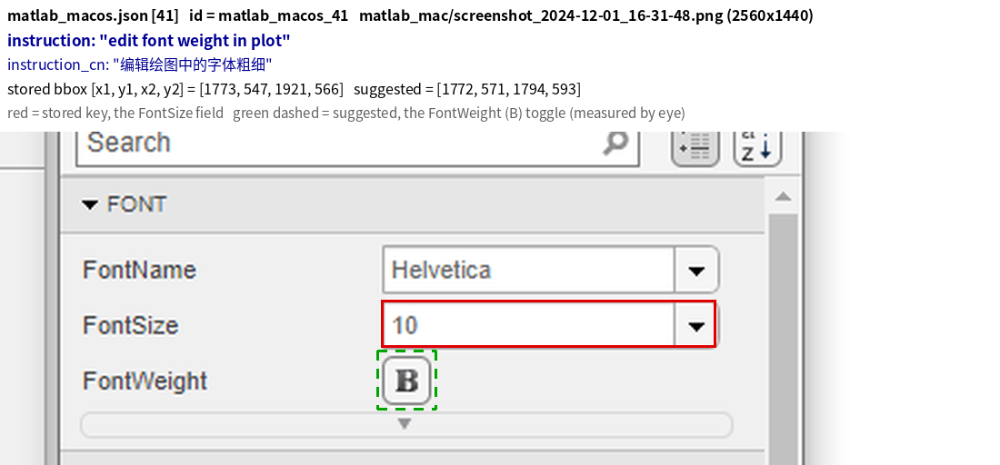
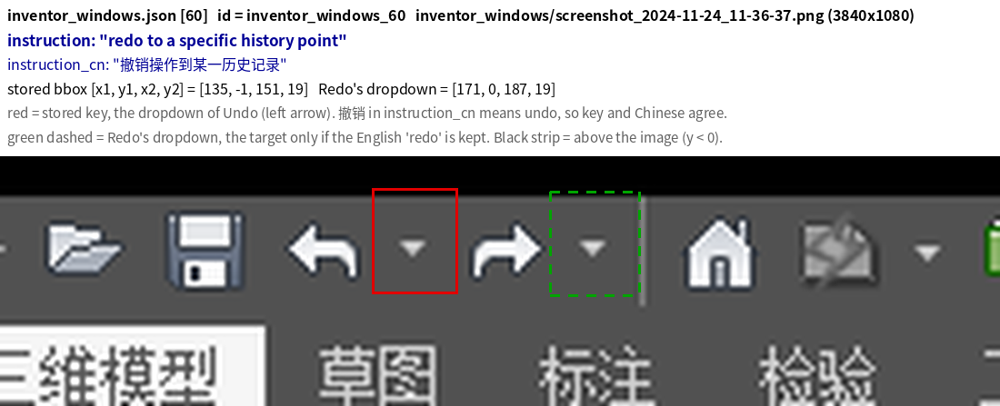
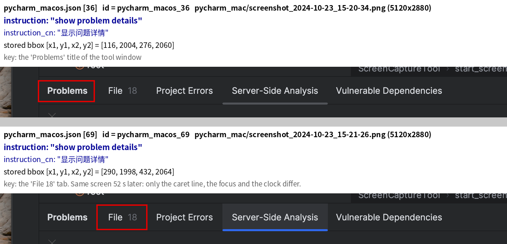
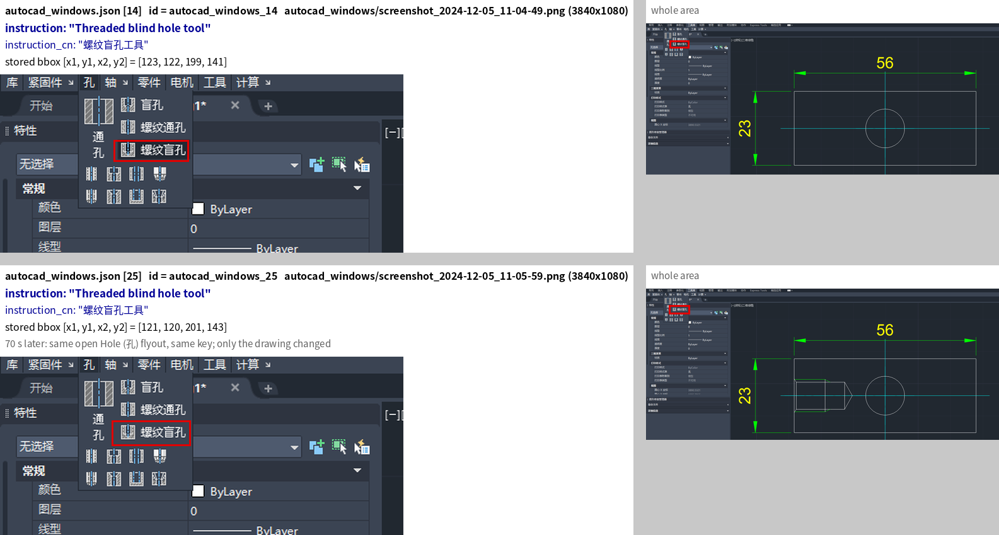
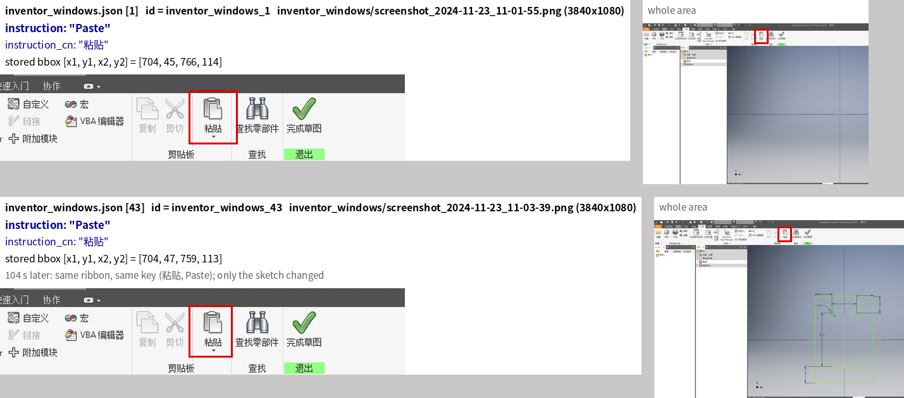
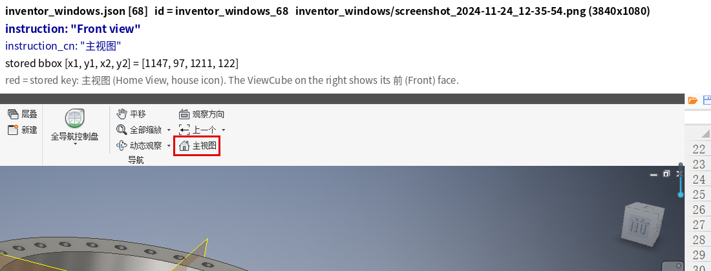
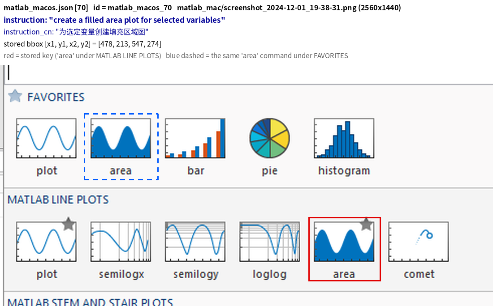
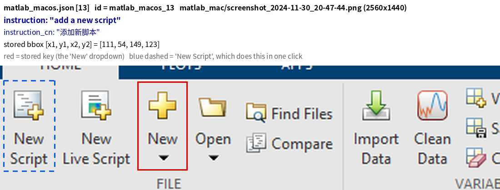
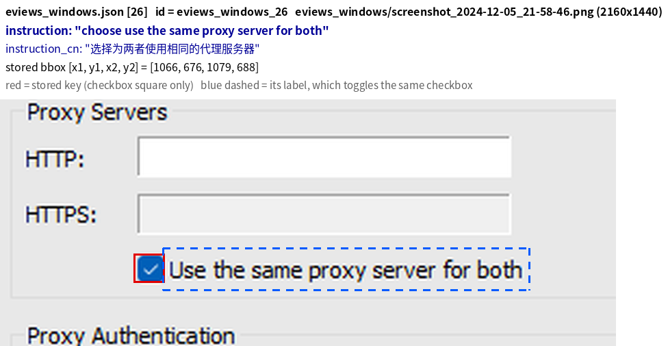

<!-- POSTED Oct 17 2026 12:10 CEST: https://github.com/likaixin2000/ScreenSpot-Pro-GUI-Grounding/issues/32 (figures hosted in gist 8fc2cc74272e1a78ec678b48d198a300, raw links pinned to a8c6438). HF version posted 12:32: https://huggingface.co/datasets/likaixin/ScreenSpot-Pro/discussions/5.
     This file is the posted text, with local figure paths. Edits to the draft before posting (Arthur's choices): no miss count in Scope,
     and only the meaning-changing wording cases (the 5 word-for-word ones now count as loosely worded in section 6, 49 -> 54).
     Checks behind every line: VERIFY.md. Prior reports: PRIOR-REPORTS.md. -->

**Title:** ScreenSpot-Pro: 3 wrong labels, 1 contradictory pair and 2 near-duplicate cases

Hi, and thanks for ScreenSpot-Pro. While benchmarking a model on it I looked at the cases the model missed, and found a few labels that look wrong. Below is everything with ids and file names, so it's easy to check.

Data: the HF dataset likaixin/ScreenSpot-Pro at revision `210e78d`. Each `id` is the annotation file plus the 0-based index in it (`blender_windows_19` is entry 19 of `annotations/blender_windows.json`). Boxes are `[x1, y1, x2, y2]` in original pixels, as stored.

## 1. Wrong labels

**`blender_windows_19`** `blender_windows/screenshot_2024-11-27_16-59-24.png` (2560x1440)
- Instruction: "Move the cone one the X axis by dragging it" (`instruction_cn`: 拖动以在X轴上移动锥体。)
- Stored bbox: `[841, 399, 902, 419]`, the green arrow of the move gizmo. Green is Y: the navigation gizmo on the same screenshot shows red X and green Y.
- The X handle is the red arrow. Suggested: `[917, 399, 971, 419]` (measured by eye, same height as the stored box).

**`matlab_macos_41`** `matlab_mac/screenshot_2024-12-01_16-31-48.png` (2560x1440)
- Instruction: "edit font weight in plot" (`instruction_cn`: 编辑绘图中的字体粗细)
- Stored bbox: `[1773, 547, 1921, 566]`, the FontSize field of the Property Inspector.
- FontWeight is the row below, a bold "B" toggle. Suggested: `[1772, 571, 1794, 593]` (measured by eye).

**`inventor_windows_60`** `inventor_windows/screenshot_2024-11-24_11-36-37.png` (3840x1080)
- Instruction: "redo to a specific history point". `instruction_cn`: 撤销操作到某一历史记录, which says undo.
- Stored bbox: `[135, -1, 151, 19]`, the dropdown next to Undo. So the box matches the Chinese, and only the English says redo.
- Suggested: change the English to "undo to a specific history point" and keep the box. If redo was meant, Redo's dropdown is at about `[171, 0, 187, 19]`.

## 2. Same screen, same words, two different keys

**`pycharm_macos_36`** and **`pycharm_macos_69`**, "show problem details" (显示问题详情)
- `pycharm_mac/screenshot_2024-10-23_15-20-34.png` and `pycharm_mac/screenshot_2024-10-23_15-21-26.png` (5120x2880) are the same screen 52 s apart. Only the caret line, the window focus and the clock differ.
- `pycharm_macos_36` keys the "Problems" title `[116, 2004, 276, 2060]`. `pycharm_macos_69` keys the "File 18" tab `[290, 1998, 432, 2064]`.
- The boxes don't overlap, so the same answer can only be right in one of the two. Accepting both boxes in both cases would fix it, or one key could change. The File tab is the one that lists the problems; the title is the tool window's name.

## 3. Near-duplicate cases

Each pair has the same instruction and the same key on a re-shot of the same screen, a minute or two later, so it tests the same thing twice:
- **`autocad_windows_14`** and **`autocad_windows_25`**, "Threaded blind hole tool": `autocad_windows/screenshot_2024-12-05_11-04-49.png` and `autocad_windows/screenshot_2024-12-05_11-05-59.png`. Same open Hole (孔) flyout, keys `[123, 122, 199, 141]` and `[121, 120, 201, 143]`, both on 螺纹盲孔. Only the drawing changed.
- **`inventor_windows_1`** and **`inventor_windows_43`**, "Paste": `inventor_windows/screenshot_2024-11-23_11-01-55.png` and `inventor_windows/screenshot_2024-11-23_11-03-39.png`. Same ribbon, keys `[704, 45, 766, 114]` and `[704, 47, 759, 113]`, both on 粘贴. Only the sketch changed.

## 4. Wording

On the Chinese-UI apps, many English instructions read like word-for-word translations of the Chinese labels on screen. That mostly still works, since the words stay close to the labels. In a few cases, though, the English points at something else, and a few English-UI cases are cut short. Where the English and `instruction_cn` disagree, the Chinese is usually the one that matches the screen. The keys are right in all of these.

- **`inventor_windows_68`** `inventor_windows/screenshot_2024-11-24_12-35-54.png`, "Front view" (主视图). The key `[1147, 97, 1211, 122]` is the 主视图 button, which is Home View (house icon). 主视图 also means front view in technical drawing, and the same screenshot shows the ViewCube's 前 (Front) face. Suggested English: "home view".
- **`inventor_windows_54`** `inventor_windows/screenshot_2024-11-23_11-15-28.png`, "Draw a curve." (画圆弧, draw an arc). The key `[156, 49, 195, 111]` is 圆弧, Arc.
- **`origin_windows_42`** `origin_windows/screenshot_2024-12-05_16-55-42.png`, "import into excel" (导入到Excel). The key `[1300, 74, 1323, 95]` is Import Excel, which imports from Excel. Both languages reverse it.
- **`powerpoint_windows_1`** `ppt_windows/screenshot_2024-10-25_15-57-36.png`, "Und" (撤销). Cut short; the key `[45, 5, 80, 30]` is Undo.
- **`vivado_windows_56`** `vivado_windows/screenshot_2024-12-09_22-45-23.png`, "open IP properties in vivado". The IP Properties pane is already open, and the key `[1035, 773, 1052, 798]` is its ? button. Similar cases say "open help of IP catalog in vivado" (`vivado_windows_34`) and "open help of source in vivado" (`vivado_windows_59`), so "help of" looks dropped, in both languages.
- **`fruitloops_windows_21`** `fruitloops_windows/screenshot_2024-10-31_19-21-15.png`, "use smart fine tool" (使用智能精细工具). The key `[49, 85, 67, 105]` is the Browser's Search button, so "fine" is probably "find".

## 5. Minor notes

- `inventor_windows_60`'s box starts at y = -1, one pixel above the image. It's the only box outside its image. Harmless, just noting it in case someone validates boxes strictly.
- The paper says each instruction is in a unique screenshot, but 23 screenshots are stored two or more times under different file names (byte-identical files, 30 extra copies), so there are 1,551 distinct images. Each copy has its own instruction and key, so the cases themselves are fine.

## 6. Judgment calls (opinions, unlike the above)

Separately, 54 of the missed cases have an instruction that I think fits another element about as well as the key: 23 with two valid answers, 18 where the key covers only part of one control (for example a checkbox square but not its label), and 13 loosely worded. Any of them could reasonably stay as they are. Three examples:

- **`matlab_macos_70`** `matlab_mac/screenshot_2024-12-01_19-38-31.png`, "create a filled area plot for selected variables". The open plot gallery shows the same "area" command twice, under FAVORITES and under MATLAB LINE PLOTS. The key `[478, 213, 547, 274]` is only the second one.
- **`matlab_macos_13`** `matlab_mac/screenshot_2024-11-30_20-47-44.png`, "add a new script". The key `[111, 54, 149, 123]` is the "New" dropdown. The "New Script" button next to it does this in one click.
- **`eviews_windows_26`** `eviews_windows/screenshot_2024-12-05_21-58-46.png`, "choose use the same proxy server for both". The key `[1066, 676, 1079, 688]` covers only the checkbox square. Clicking its label toggles the same checkbox.

Happy to share the full list with screenshots if it's useful.

## Scope

I only checked the labels of the cases one model missed, so this isn't a full audit of the dataset. The duplicate, contradiction and box-range scans covered all 1,581 cases. Since every published score uses the current key, a small errata file next to the dataset might be easier than changing the key in place. People could then report both numbers, and an errata keyed by `id` would also reach the mirrors (lmms-lab, Voxel51 and others), which copy the key as it is. Where `instruction_cn` is right and only the English is off (`inventor_windows_60`, `inventor_windows_68`, `inventor_windows_54`, `powerpoint_windows_1`), the errata could fix just the English.
