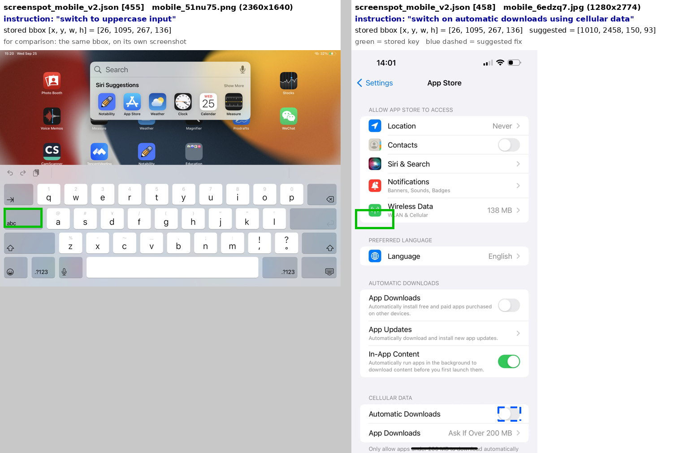
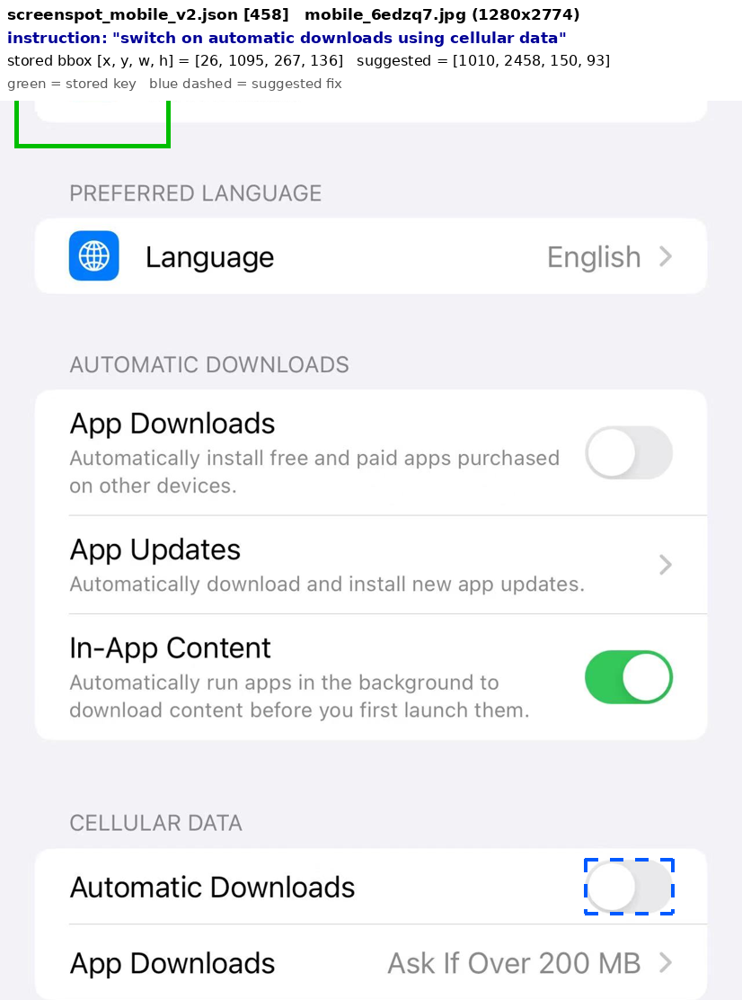
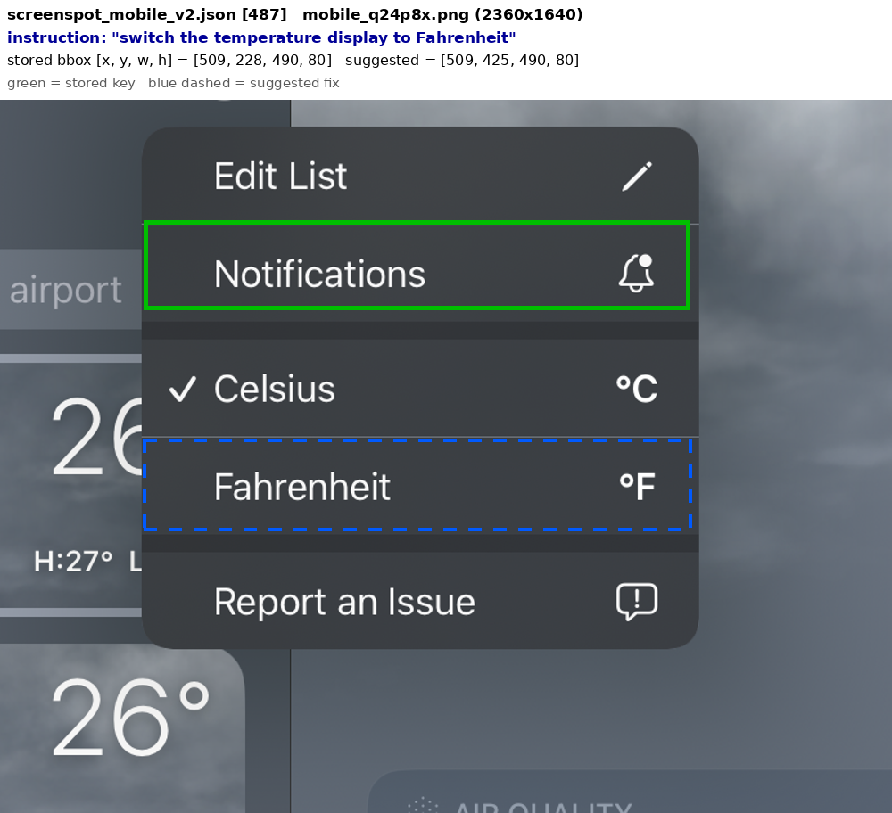
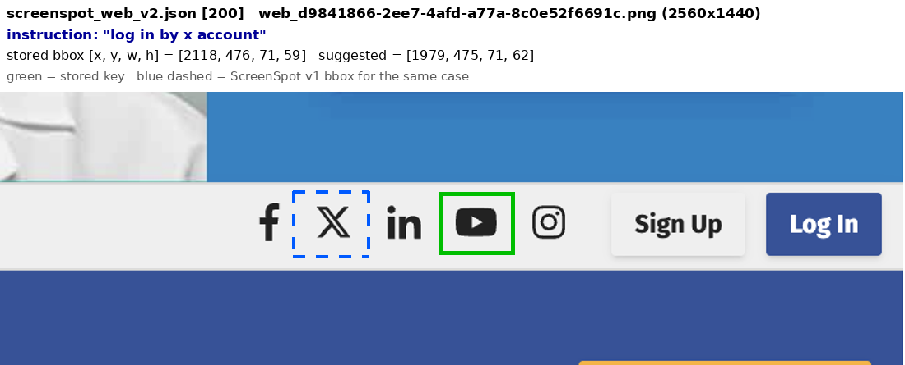
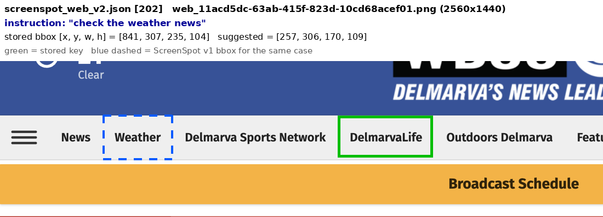
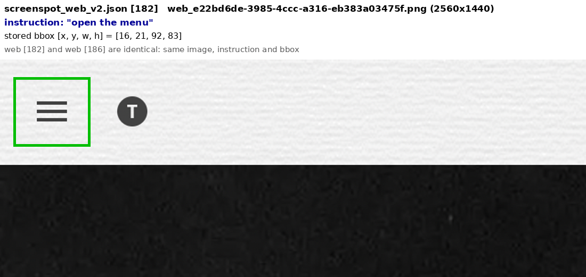
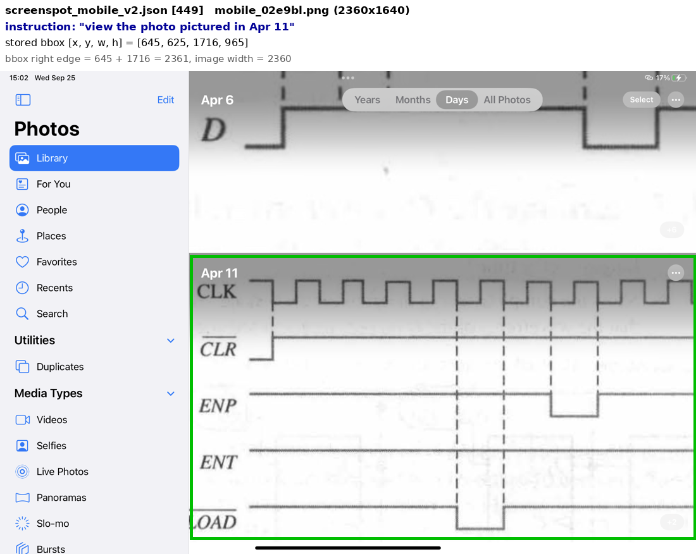
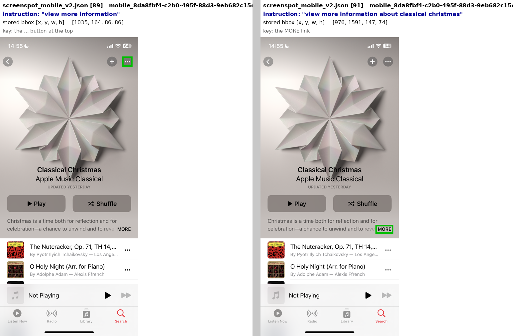
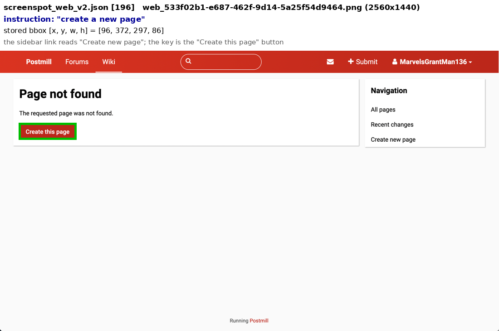
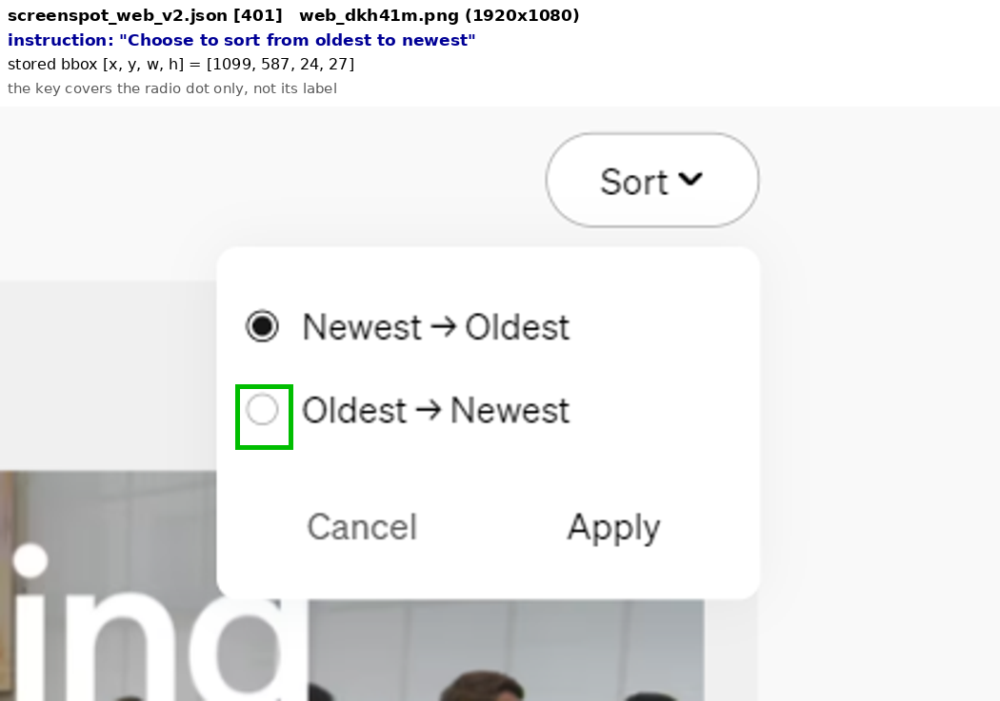

<!-- POSTED Oct 17 2026: https://github.com/OS-Copilot/OS-Atlas/issues/65 (figures hosted in gist fb23967a36431273b6c6b89553b79880). HF version not posted yet. -->

**Title:** ScreenSpot-v2: 4 wrong answer boxes and 1 duplicate case

Hi, and thanks for ScreenSpot-v2. While benchmarking a model on it I looked at the cases the model missed, and found a few labels that look wrong. Below is everything with file names and indices, so it's easy to check.

Indices are 0-based positions in `screenspot_{mobile,desktop,web}_v2.json` from the HF dataset. Boxes are `[x, y, w, h]` in original pixels, as stored.

## 1. Answer boxes on the wrong element

**mobile [458]** `mobile_6edzq7.jpg` (1280x2774)
- Instruction: "switch on automatic downloads using cellular data"
- Stored bbox: `[26, 1095, 267, 136]`
- That's exactly the bbox of mobile [455] (`mobile_51nu75.png`, "switch to uppercase input"), where it marks the "abc" key. On this screenshot it lands on empty space next to the Wireless Data icon. It looks copied from [455].
- The target is the Automatic Downloads toggle under CELLULAR DATA. Suggested: `[1010, 2458, 150, 93]` (measured by eye).

**mobile [487]** `mobile_q24p8x.png` (2360x1640)
- Instruction: "switch the temperature display to Fahrenheit"
- Stored bbox: `[509, 228, 490, 80]`, the Notifications row of the menu.
- The target is the Fahrenheit row, two rows down. Suggested: `[509, 425, 490, 80]` (measured by eye, same size as the stored box).

**web [200]** `web_d9841866-2ee7-4afd-a77a-8c0e52f6691c.png` (2560x1440)
- Instruction: "log in by x account"
- Stored bbox: `[2118, 476, 71, 59]`, the YouTube icon.
- The X icon is two icons to the left. ScreenSpot v1 has this same case with `[1979, 475, 71, 62]`, which is on the X icon. Suggested: restore the v1 box.

**web [202]** `web_11acd5dc-63ab-415f-823d-10cd68acef01.png` (2560x1440)
- Instruction: "check the weather news"
- Stored bbox: `[841, 307, 235, 104]`, the "DelmarvaLife" menu item.
- The Weather item is two to the left. ScreenSpot v1 has `[257, 306, 170, 109]` for this case, which is on Weather. Suggested: restore the v1 box.

For web [200] and [202], v1 was right and the box changed in v2. Only 9 boxes changed between v1 and v2 for the same image and instruction, so these two may be worth a look together with the others.

## 2. Duplicate case

**web [182]** and **web [186]** are identical: same image (`web_e22bd6de-3985-4ccc-a316-eb383a03475f.png`), same instruction ("open the menu"), same bbox `[16, 21, 92, 83]`. v1 has this case once.

## 3. A box 1 px past the image edge (harmless)

**mobile [449]** `mobile_02e9bl.png` (2360x1640), "view the photo pictured in Apr 11". The bbox `[645, 625, 1716, 965]` ends at x = 2361, one pixel past the 2360 px width. It doesn't change any score; just noting it in case someone validates boxes strictly.

## 4. Judgment calls (opinions, unlike the above)

Separately, 39 of the missed cases have an instruction that I think fits another element about as well as the key: 18 with two valid answers, 12 where the key covers only part of one control (for example a radio dot but not its label), 8 loosely worded, and 1 I couldn't verify. These are opinions, and any of them could reasonably stay as they are. Three examples:

- **mobile [89]** "view more information" (`mobile_8da8fbf4-c2b0-495f-88d3-9eb682c15ce7.png`). The key is the ... button `[1035, 164, 86, 86]`. On the same screenshot, mobile [91] "view more information about classical christmas" uses the MORE link `[976, 1591, 147, 74]`, so the MORE link also fits "view more information".
- **web [196]** "create a new page" (`web_533f02b1-e687-462f-9d14-5a25f54d9464.png`). The key is the "Create this page" button `[96, 372, 297, 86]`. The sidebar has a link that reads exactly "Create new page".
- **web [401]** "Choose to sort from oldest to newest" (`web_dkh41m.png`). The key `[1099, 587, 24, 27]` covers only the radio dot. Clicking the "Oldest → Newest" label selects the same option.

Happy to share the full list with screenshots if it's useful.

## Scope

I only looked at the cases one model missed, so this isn't a full audit of the dataset. Since every published score uses the current key, a small errata file next to the dataset might be easier than changing the key in place. People could then report both numbers.
